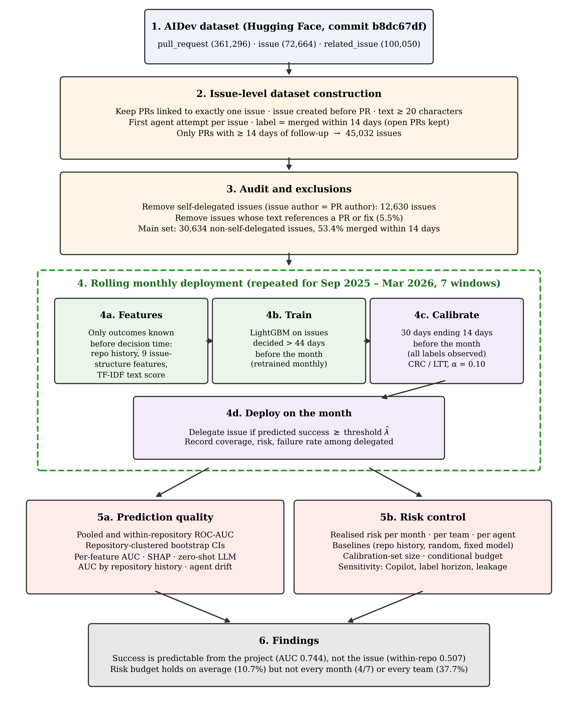

# Projects, Not Issues

**Risk-controlled screening of AI coding agent delegation on GitHub**

AI coding agents such as Claude Code, GitHub Copilot, OpenAI Codex and Devin can turn a GitHub issue into a pull request on their own. About half of those pull requests are never merged, and each failed one costs maintainers review time. This repository asks: *before an agent starts, can a team tell which issues are worth delegating, while keeping failed agent pull requests within a budget it chooses?*

It contains the full, reproducible pipeline for the M.Tech thesis and the paper *Projects, Not Issues: Risk-Controlled Screening of AI Coding Agent Delegation on GitHub* (Owjasweeta Changmai and Ritu Agarwal, Department of Information Technology, Delhi Technological University).



## Main findings

On 30,634 delegated GitHub issues from the [AIDev](https://huggingface.co/datasets/hao-li/AIDev) dataset, evaluated month by month from September 2025 to March 2026:

| Finding | Evidence |
|---|---|
| Agent success is predictable **across** projects but **not within** them | Pooled AUC 0.744; within-repository AUC 0.507 (95% CI 0.463–0.538) |
| Issue text, structure and a zero-shot language model add nothing within a project | Every issue feature at 0.48–0.52 within repositories; LLM AUC 0.429 |
| The signal decays quickly | A model that is never retrained falls to AUC 0.487 |
| Conformal risk control holds a 10% failure budget on average… | Realised risk 10.7% (9.1–12.3%); success among delegated issues 74.3% vs 55.3% |
| …but not window by window | Budget exceeded in 7 of 14 bi-weekly windows |
| Early review signals reveal recent risk within a day, yet symmetric online correction still fails | Correlation 0.995; 6 of 14 windows still violated |
| Broader repository history plus a safety margin works best | 38.4% of issues delegated, budget exceeded in 1 of 14 windows |

## Repository structure

```
projects-not-issues/
├── README.md
├── LICENSE                     MIT licence for the code
├── requirements.txt            Library versions used for the reported results
├── notebooks/
│   └── pipeline.ipynb          The whole study, steps 0–21, each with an explanation
├── data/
│   └── README.md               Dataset version and how the data are obtained
├── results/
│   ├── README.md               What each result file contains
│   └── results_*.csv           Result tables written by the notebook
├── figures/
│   └── fig_*.png               Figures written by the notebook
├── label_validation/
│   ├── README.md               Coding scheme for failed pull requests
│   └── label_validation_sample.csv   200 failed PRs to code by hand
```

## How to reproduce

1. Open [`notebooks/pipeline.ipynb`](notebooks/pipeline.ipynb) in Google Colab.
2. Choose **Runtime → Change runtime type → T4 GPU**.
3. Choose **Runtime → Run all**. The notebook downloads the data from Hugging Face, so nothing needs to be uploaded.
4. Results and figures are written to the session and archived to `MyDrive/agent_routing/revision_results.zip`.

The full run takes about 90 minutes without step 6b and about 2.5 hours with it. Only steps 6 and 6b need a GPU. All random seeds are fixed, so results are reproducible with the library versions in `requirements.txt`.

To include Llama-3.1-8B in step 6b, accept its licence on Hugging Face and add your token as a Colab secret named `HF_TOKEN`. Without it, that model is skipped.

### Notebook steps

| Step | What it does |
|---|---|
| 0 | Install libraries and print versions |
| 1 | Build the dataset: 14-day merge label, censoring, self-delegation and leakage audit |
| 2 | Rolling monthly deployment: time-respecting features, LightGBM, CRC and LTT thresholds, baselines |
| 3 | SHAP attributions |
| 4 | Repository-clustered bootstrap intervals and within-repository AUC |
| 5 | Robustness checks: agent drift, selection steps, label horizon, Copilot sensitivity |
| 6 | Zero-shot language-model baseline (Qwen2.5-1.5B) |
| 7 | Sample of 200 failed pull requests for manual label validation |
| 8 | Pooled and within-repository AUC of every feature |
| 9 | Results across risk budgets from 0.05 to 0.30 |
| 10 | Bi-weekly deployment, safety margin, online adjustment, simpler policies, cold start |
| 11 | Inspection of the pull-request timeline table |
| 12 | Accuracy, precision, recall and F1 |
| 13 | All thesis figures |
| 14 | Policies for repositories with no agent history |
| 15 | Decision-time checks |
| 16 | Group-conditional (hierarchical) thresholds |
| 17 | Online risk control with early review signals |
| 18 | Asymmetric online risk control |
| 19 | Broader repository history and repository metadata |
| 20 | Ablation and the combined policy |
| 21 | Save all results |

## Data

The study uses the AIDev dataset ([Li, Zhang and Hassan, 2025](https://arxiv.org/abs/2507.15003)) at commit `b8dc67df93e7c11f6f20c84129db7232eb1ec253`, whose latest timestamp is 7 April 2026. No raw data is stored here; see [`data/README.md`](data/README.md).

## Licence

The code is released under the [MIT licence](LICENSE). The AIDev data are subject to their own licence, and each GitHub repository in them keeps its own licence.
